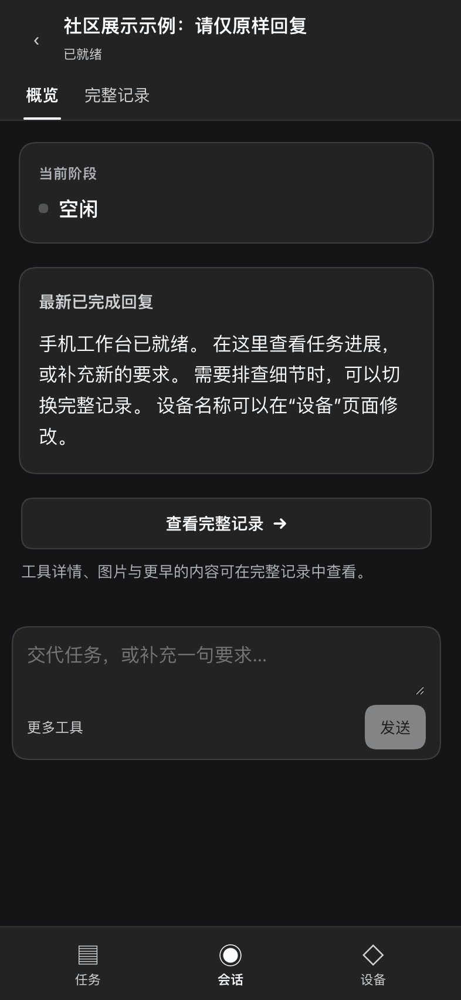

# dsh-mobile

简体中文 | [English](README.en.md)

[DeepSeek Harness（DSH）](https://github.com/deepseek-ai/deepseek-harness) 的全屏手机工作台，以任务为中心组织需要你处理的工作、会话概览和继续对话的入口，使用同一个 DSH Host 与会话记录。

这是独立维护的社区 UI 插件，可在能够访问 DSH 的浏览器中单独使用。如需临时 HTTPS 远程入口与手机配对，可加装 [dsh-remote-control](https://github.com/slicenferqin/dsh-remote-control)；当前完整手机体验建议两个都装。

## 宣传片

https://github.com/user-attachments/assets/763e9698-6479-40da-9685-b201a600c2e4

[下载完整 MP4](https://github.com/slicenferqin/dsh-mobile/releases/download/v0.1.0/DSH-Anywhere-30s.mp4) · [GIF 预览](https://github.com/slicenferqin/dsh-mobile/releases/download/v0.1.0/DSH-Anywhere-preview.gif) · [封面](https://github.com/slicenferqin/dsh-mobile/releases/download/v0.1.0/DSH-Anywhere-cover.png)

30 秒宣传片，16:9、1080p 60 fps，使用原创音乐与音效，中文画面，无口播。

## 界面预览

<p align="center"></p>

截图使用中文界面和公开演示会话。

## 功能

- **任务：** 优先排列待你处理的工作，再显示进行中和已就绪会话；按名称或工作区搜索，在已有工作区中新建任务。
- **概览：** 查看待处理问题或审批、当前阶段、最近正文进展、最新已完成回复及折叠的此前结果。
- **完整记录：** 使用 DSH 原有会话渲染器查看历史、工具详情、图片和交互。
- **简洁输入：** 发送文字和停止任务；通过 **更多工具** 打开完整编辑器。包含附件、结构化引用或命令时会自动恢复完整编辑器。
- **设备：** 配合 dsh-remote-control 修改当前已配对设备名称，或切回桌面界面。

概览只是已有会话原文与状态的展示投影，**不是模型生成的摘要，也不会额外调用模型**。

## 兼容性

- **Node.js 22.19 或更新版本**，已安装 DSH；profile 包管理需要 `PATH` 中有 `pnpm`。
- 声明的 DSH 版本范围：`>=0.2.1-rc.2 <0.3.0`。Client / Slot API 尚未稳定，升级 DSH 可能需要同步更新插件。
- 已在 **DSH 0.2.1-rc.2 源码构建版、macOS arm64** 上完成 live 浏览器验证；并未对所有操作系统、浏览器和设备组合完成端到端验证。
- 本版面向 DSH Web UI。宽屏桌面窗口默认保持原布局。

## 安装与启动

通过 GitHub tag 安装到 Web profile：

```sh
dsh plugin --profile web add github:slicenferqin/dsh-mobile#v0.1.0
```

如需通过临时 HTTPS 隧道从手机访问，再安装：

```sh
dsh plugin --profile web add github:slicenferqin/dsh-remote-control#v0.3.0
```

使用 `dsh web`（或 `dsh --profile web`）启动。若已运行，CLI 安装后请重启该 profile，再刷新页面。[GitHub Releases](https://github.com/slicenferqin/dsh-mobile/releases) 也提供发行压缩包，无需发布到 npm。

DSH 默认 Web 监听位于电脑本机（`127.0.0.1`），dsh-mobile 本身不会将其开放给手机。远程使用请按 [remote-control 安装与配对文档](https://github.com/slicenferqin/dsh-remote-control#安装与启动) 操作：在电脑安装 cloudflared，打开 **设置 → 远程控制**，扫码后确认设备名称，再明确点击 **配对并进入**。Quick Tunnel 无需 Cloudflare 账号或域名，但首次启动可能接近一分钟。其桥接要求 DSH origin 使用 `localhost`、`127.0.0.1` 或 `[::1]`，不支持 LAN 地址及通配监听目标。

## 使用与配置

窗口宽度**不超过 900 CSS 像素**时自动进入工作台。底部提供 **任务、会话、设备** 三个入口。打开任务默认显示概览；切换到 **完整记录** 可进入完整对话界面。新任务使用已有 DSH 工作区；缺少工作区时，请先在桌面界面创建。

在 **设备 → 切回桌面界面** 返回原界面。窄屏桌面界面底部提供恢复手机工作台的按钮。设置侧栏没有单独的手机工作台入口。

本版没有 Host 配置字段。布局偏好与选中会话只存储在当前浏览器。默认自动模式不改变宽屏桌面布局；手动恢复工作台的偏好会作用于该浏览器。

## 限制与安全范围

概览只使用**已加载的会话历史**，展示最新已完成的文字回复和最多三条此前已完成结果，不表示已概括全部存储历史，也不根据未完成正文推断任务完成。概览不展示推理、原始工具参数、图片和长日志；请在 **完整记录** 查看，通过 **更多工具** 使用复杂输入或操作。

插件展示现有 DSH 数据，沿用原有会话、输入、排队、停止、提问和审批机制，不新增网络监听、远程访问服务、独立账号或权限边界。所有操作继续受 Host 的既有权限约束。设备自助更名需要通过 remote-control 配对连接；其他工作台功能不依赖该插件。

配合 dsh-remote-control 时，已配对手机拥有 **Host 的 owner 权限**，包括其权限策略允许的本机文件及命令能力。这不是只读界面或操作系统远程桌面，也不会锁定电脑。详见 [远程插件的安全范围与有效期说明](https://github.com/slicenferqin/dsh-remote-control#安全范围与限制)。默认 8 小时访问有效期和滚动 10 天刷新窗口仅适用于同一远程入口持续运行：关闭入口、重启 DSH、重载 Host 插件或更换隧道域名都会清空配对。

## 开发与测试

包中包含可读源码、构建脚本和测试。在仓库根目录或解压后的源码包中执行：

```sh
pnpm install --ignore-scripts
pnpm run build
pnpm run check
pnpm test
```

构建会打包 Markdown 解析与净化依赖；运行时从 DSH Host 加载 React。测试覆盖概览正文选择、完成证据、历史数量边界、进展和待处理事项优先级，不能替代浏览器及设备验证。本地试用可在仓库根目录运行 `dsh plugin --profile web add .` 安装 checkout，然后重启 Web profile 并刷新页面。

## 许可证

[MIT](LICENSE)。打包依赖的许可证说明见 [第三方声明](THIRD_PARTY_NOTICES.md)。
